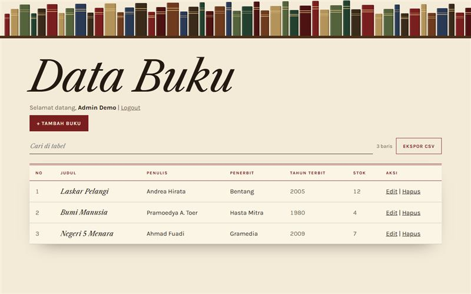

# Katalog Buku

Aplikasi manajemen buku PHP dan MySQL untuk Uji Kompetensi.

**Demo:** https://portofolio-jauza-fawaid.netlify.app/DATA-BUKU/ (pratinjau statis dengan data contoh)

## Fitur

- Login dengan kata sandi ter-hash
- CRUD data buku
- Token CSRF untuk login dan hapus
- Pencarian tabel dan ekspor CSV

## Menjalankan

1. Salin folder ini ke `htdocs`, lalu jalankan Apache dan MySQL di XAMPP.
2. Impor `database.sql` lewat phpMyAdmin. Berkas ini membuat database `ujk`.
3. Buka `login.php`. Akun demo ada di `database.sql`, ganti sebelum dipasang di server.

Pengaturan koneksi bisa diubah lewat variabel lingkungan `DB_HOST`, `DB_PORT`, `DB_NAME`, `DB_USER`, dan `DB_PASS`.

## Teknologi

PHP, MySQL, JavaScript
